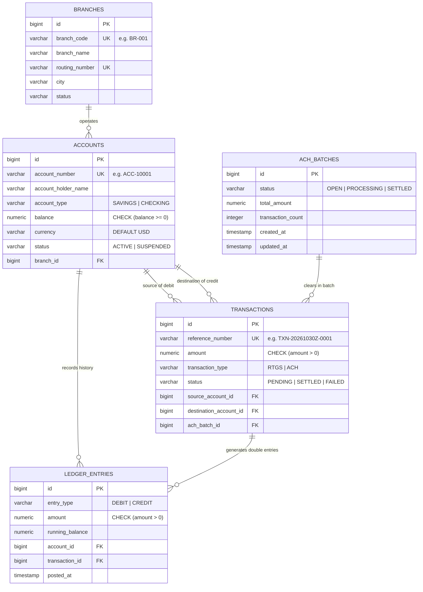

# LedgerFlow — Institutional Multi-Branch Core Banking & Multilateral Settlement Platform

> **DBMS Experiential Learning – Level 3 Project Submission**  
> **Course Instructor:** Dr. Nagasundari S  
> **Project Repository:** [GitHub - LedgerFlow](https://github.com/pallaviB463/LedgerFlow-Multi_Branch_Banking_Settlement_Platform)  
> **Branch:** `feature/ledgerflow-integration`

---

## 🏛️ Executive Summary

**LedgerFlow** is an institutional-grade, multi-branch core banking and automated inter-branch clearing engine designed to simulate modern retail banking, real-time gross settlement (RTGS), and multilateral automated clearing house (ACH) batch net settlement.

Built upon strict **double-entry bookkeeping** principles, LedgerFlow guarantees that every debit is matched by an equal and opposite credit across branches, eliminating money creation or leakage. To fulfill modern regulatory requirements and handle high-throughput auditing, LedgerFlow implements a **Polyglot Persistence Architecture (Dual Database Paradigm)** pairing an ACID-compliant relational SQL engine (**PostgreSQL 16**) with an immutable document NoSQL audit engine (**MongoDB 7.0**).

---

## 🌐 Dual Database Paradigm Architecture (Rubric Section 3)

The architecture bifurcates financial transactional workloads and regulatory audit logging based on data characteristics and storage paradigms:

```
                      ┌────────────────────────────────────────┐
                      │    Next.js 14 Swiss FinTech Web UI     │
                      │     (Role-Based Portals: Port 3000)    │
                      └──────────────────┬─────────────────────┘
                                         │ REST APIs (JWT Auth / RBAC)
                      ┌──────────────────▼─────────────────────┐
                      │      Spring Boot 3.2.5 Core Server     │
                      │               (Port 8080)              │
                      └──────────┬───────────────────┬─────────┘
                                 │                   │
                  [ACID Banking Core]      [NoSQL Audit Stream]
                                 │                   │
             ┌───────────────────▼───────┐  ┌────────▼──────────────────┐
             │       PostgreSQL 16       │  │        MongoDB 7.0        │
             │     (Relational / SQL)    │  │     (Document / NoSQL)    │
             ├───────────────────────────┤  ├───────────────────────────┤
             │ • Double-entry Ledger     │  │ • Compliance Audit Trails │
             │ • Pessimistic Row Locking │  │ • ACH Clearing Receipts   │
             │ • SQL Views & Triggers    │  │ • 4-Stage Aggregation     │
             │ • Strict CHECK & FK rules │  │   Pipelines (Risk Matrix) │
             └───────────────────────────┘  └───────────────────────────┘
```

### Paradigm Justification

| Feature Dimension | PostgreSQL 16 (Relational SQL) | MongoDB 7.0 (Document NoSQL) |
| :--- | :--- | :--- |
| **Primary Responsibility** | Core ledger balances, branch accounts, atomic money movements, ACH batch lifecycle. | Regulatory compliance events, non-repudiation audit trails, immutable clearing receipts. |
| **Data Model** | Strongly typed 3NF relational schema with strict referential integrity (PK/FK). | Flexible, schema-less BSON documents storing semi-structured event payloads. |
| **Consistency Guarantee** | Immediate Consistency (ACID) with `REPEATABLE_READ` transaction isolation & row locks. | High-throughput write durability with non-blocking eventual compliance streams. |
| **Integrity Enforcement** | Hard database constraints: `CHECK (balance >= 0)`, foreign keys, PL/pgSQL triggers. | Document schemas accommodating arbitrary transaction metadata & batch netting snapshots. |
| **Advanced Query Capability** | Relational SQL Views (`v_trial_balance`) & recursive balance calculation functions. | Multi-stage Aggregation Pipeline (`$match` $\rightarrow$ `$group` $\rightarrow$ `$project` $\rightarrow$ `$sort`). |

---

## 📐 Relational Schema & Entity-Relationship Model (Rubric Section 5)

The relational engine models multi-branch banking operations across 5 normalized tables in PostgreSQL:



---

## ⚡ Advanced Database Concepts Implemented (Rubric Section 7)

### 1. Advanced SQL Concepts (PostgreSQL)

#### A. ACID Transactions & Pessimistic Concurrency (`PESSIMISTIC_WRITE`)
- Multi-threaded financial operations execute under `REPEATABLE_READ` transaction isolation.
- Account records are acquired with `SELECT ... FOR UPDATE` ordered deterministically by primary key (`id ASC`) to mathematically eliminate deadlock risk (`40P01`) under high concurrency.
- Ensures zero double-spending when concurrent debits target the same balance.

#### B. Indexing Strategy
Explicit composite and B-tree indexes defined in `scripts/schema.sql` optimize ledger lookups and prevent table scans:
- `idx_ledger_account_created`: `(account_id, posted_at DESC)` — Optimizes chronological bank statement rendering.
- `idx_transactions_type_status`: `(transaction_type, status)` — Accelerates ACH batch gathering queries.
- `idx_ach_batches_status`: `(status)` — Enables immediate retrieval of open clearing batches.

#### C. Relational SQL Views
- **`v_trial_balance`**: Computes inter-branch trial balance by joining `branches`, `accounts`, and `ledger_entries`, summing all debits and credits per branch:
  ```sql
  CREATE OR REPLACE VIEW v_trial_balance AS
  SELECT 
      b.id AS branch_id,
      b.branch_code,
      b.branch_name,
      b.city,
      COALESCE(SUM(CASE WHEN le.entry_type = 'DEBIT' THEN le.amount ELSE 0 END), 0) AS total_debit,
      COALESCE(SUM(CASE WHEN le.entry_type = 'CREDIT' THEN le.amount ELSE 0 END), 0) AS total_credit,
      COALESCE(SUM(CASE WHEN le.entry_type = 'CREDIT' THEN le.amount ELSE -le.amount END), 0) AS net_balance,
      COUNT(DISTINCT a.id) AS total_accounts
  FROM branches b
  LEFT JOIN accounts a ON a.branch_id = b.id
  LEFT JOIN ledger_entries le ON le.account_id = a.id
  GROUP BY b.id, b.branch_code, b.branch_name, b.city;
  ```
- **`v_branch_settlement_summary`**: Summarizes cross-branch multilateral gross exposures.

#### D. Stored Functions & Triggers
- **`fn_calculate_account_balance(p_account_id)`**: Stored PL/pgSQL function computing the true balance directly from immutable ledger entries:
  $$\text{Balance} = \sum(\text{CREDIT}) - \sum(\text{DEBIT})$$
- **`trg_enforce_account_balance`**: Before-update trigger verifying that no account balance drops below zero, raising an exception if an invariant violation is detected.

---

### 2. Advanced NoSQL Concept (MongoDB 7.0 Multi-Stage Aggregation Pipeline)

Implemented in `ComplianceAnalyticsService.java` to monitor real-time anti-money laundering (AML) and branch risk exposure:

```
  [$match] Rolling 30-Day Window
     │
  [$group] Aggregate by (branchCode, eventType):
     │     • totalVolume:       $sum(amount)
     │     • eventCount:        $sum(1)
     │     • avgTransferSize:   $avg(amount)
     │     • maxTransferSize:   $max(amount)
     │
  [$project] Shape Risk Metrics & Re-scale Decimals
     │
  [$sort] Order by totalVolume DESC (Peak Exposure First)
```

**Java Spring Data MongoDB Aggregation Implementation:**
```java
Aggregation pipeline = Aggregation.newAggregation(
    Aggregation.match(Criteria.where("timestamp").gte(cutoff)),
    Aggregation.group("branchCode", "eventType")
        .sum("amount").as("totalVolume")
        .count().as("eventCount")
        .avg("amount").as("avgTransferSize")
        .max("amount").as("maxTransferSize"),
    Aggregation.project()
        .and("_id.branchCode").as("branchCode")
        .and("_id.eventType").as("eventType")
        .and("totalVolume").as("totalVolume")
        .and("eventCount").as("eventCount")
        .and("avgTransferSize").as("avgTransferSize")
        .and("maxTransferSize").as("maxTransferSize"),
    Aggregation.sort(Sort.Direction.DESC, "totalVolume")
);
```

---

## 🔐 Authentication & Role-Based Access Control (Rubric Section 11)

Stateless JWT authentication (HMAC-SHA256) separates permissions between bank executives and retail customers:

| Role | Permitted Operations | Restricted Operations |
| :--- | :--- | :--- |
| **`ROLE_BANK_MANAGER`** | • Create new accounts (`POST /api/accounts`)<br>• Trigger ACH batch settlement (`POST /api/ach/batches/current/settle`)<br>• Query MongoDB Aggregation Analytics (`GET /api/compliance/**`)<br>• Inspect inter-branch trial balances | None (Full administrative & settlement scope) |
| **`ROLE_CUSTOMER`** | • Initiate RTGS & ACH transfers (`POST /api/transfers`)<br>• Inquire own ledger statement (`GET /api/ledger/accounts/{id}`)<br>• View own transaction receipts | • Cannot trigger batch settlements<br>• Cannot create bank accounts<br>• Cannot access compliance analytics |

### Pre-Seeded Credentials for Grading Evaluation

| Username | Password | Role | Description / Persona |
| :--- | :--- | :--- | :--- |
| `admin` | `admin123` | `ROLE_BANK_MANAGER` | Chief Banking Officer (Full settlement & compliance analytics access) |
| `teller` | `teller123` | `ROLE_BANK_MANAGER` | Settlement Operator (Batch processing & ledger monitoring) |
| `alice` | `alice123` | `ROLE_CUSTOMER` | Retail Customer (Account `ACC-10001`, Downtown Branch) |
| `bob` | `bob123` | `ROLE_CUSTOMER` | Retail Customer (Account `ACC-10002`, Uptown Branch) |

---

## 💻 Next.js 14 Web Interface (Rubric Section 9 & 17)

A Next.js 14 frontend is located in `frontend/` featuring a clean **Swiss FinTech Minimalist** user interface (slate, deep navy, emerald, and amber):

- **`/` (Overview):** Live KPI cards, system status, PostgreSQL trial balance view (`v_trial_balance`), and recent double-entry transaction feeds.
- **`/login`:** Role switcher with 1-click test credentials to instantly switch between Manager and Customer personas.
- **`/transfers`:** Interactive Transfer Desk supporting RTGS (real-time gross settlement) and ACH (clearing batch) with dynamic account balance calculation.
- **`/settlement`:** Manager portal to trigger multi-branch ACH settlement sagas and view bilateral netting.
- **`/accounts`:** Dual-balance statement verification comparing stored table balance with dynamically computed ledger sum.
- **`/compliance`:** MongoDB Aggregation Pipeline dashboard showing branch risk exposure and live BSON audit log streams.

---

## 🚀 Step-by-Step Setup & Execution Guide

### 1. Prerequisites
- **Java JDK 17**
- **Docker & Docker Compose** (for PostgreSQL 16 & MongoDB 7.0)
- **Node.js v18+ & npm** (Node v22 verified)

---

### 2. Start PostgreSQL and MongoDB via Docker
Run the following from the project root:

```bash
docker compose up -d
```

This launches:
- **PostgreSQL 16** on `localhost:5433` (Database: `ledgerflow`, User: `postgres`, Pass: `postgres`)
- **MongoDB 7.0** on `localhost:27017` (Database: `ledgerflow_audit`)

*(Optional: Execute `scripts/schema.sql` if running raw PostgreSQL outside Spring Boot; Spring Boot automatically applies schema views and seeds initial branches and accounts).*

---

### 3. Run the Spring Boot 3 Backend
Open a terminal in the root directory:

```powershell
# Windows PowerShell:
.\mvnw.cmd spring-boot:run
```

```bash
# macOS / Linux:
./mvnw spring-boot:run
```

Backend will start on `http://localhost:8080`.

Verify health check:
```powershell
Invoke-RestMethod http://localhost:8080/api/health
```

---

### 4. Run the Next.js Frontend
Open a new terminal in the `frontend/` directory:

```powershell
cd frontend
npm install
npm run dev
```

Open your browser to:
👉 **`http://localhost:3000`**

*(Note: The Spring Boot backend also serves the embedded static Swiss FinTech dashboard at `http://localhost:8080/index.html`).*

---

## 🧪 Automated Test Suite Execution

To run unit, integration, and saga concurrency tests:

```powershell
.\mvnw.cmd test
```

Tests include:
- `ConcurrencyTest`: Verifies multi-threaded balance debit protection and pessimistic locking.
- `AchSagaTest`: Tests ACH reservation, batch settlement, and compensating transactions.
- `ReportServiceTest`: Validates double-entry ledger calculation and mathematical invariant checks.

---

## 📑 Rubric Fulfillment Checklist

- [x] **Domain Selection (Section 1):** Real-world Multi-Branch Banking & Multilateral Settlement.
- [x] **Dual Database Paradigm (Section 3):** Relational SQL (PostgreSQL 16) + Document NoSQL (MongoDB 7.0).
- [x] **Relational Modeling & DDL (Section 5):** 5 normalized tables, PK, FK, CHECK constraints, non-negativity guarantees in `scripts/schema.sql`.
- [x] **Advanced SQL Concepts (Section 7):** Transactions (Pessimistic Locking), Indexing, SQL Views (`v_trial_balance`), Stored Functions & Triggers.
- [x] **Advanced NoSQL Concept (Section 7):** MongoDB 4-Stage Aggregation Pipeline (`$match`, `$group`, `$project`, `$sort`).
- [x] **Interactive Web Frontend (Section 9):** Next.js 14 application with interactive forms and live reporting.
- [x] **Authentication & RBAC (Section 11):** Spring Security JWT with `ROLE_BANK_MANAGER` and `ROLE_CUSTOMER`.
- [x] **Soft-Copy Deliverables (Section 13):** Documented architecture, Mermaid diagrams, clean Git commit log, and reproducible Docker Compose environment.
